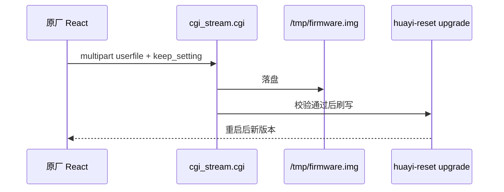
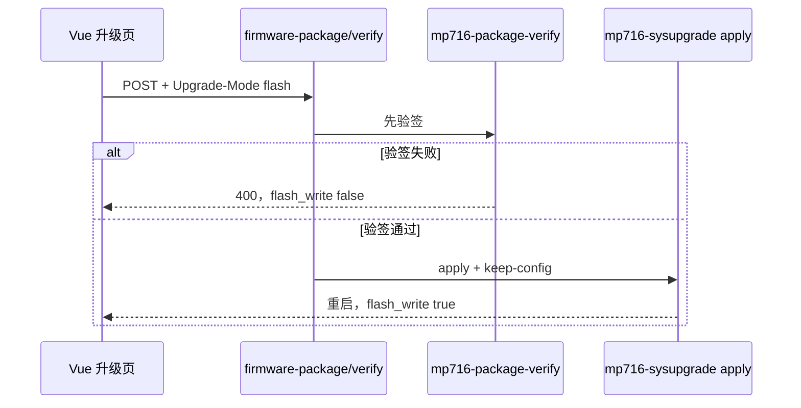

# 固件升级：参考原厂能力的闭环定义

对照 [vendor-upgrade-chain.md](../../../openwrt_system/firmware/reports/vendor-upgrade-chain.md)（014 `cgi_stream.cgi` streamid=4）与当前原生栈。

## 原厂闭环（用户视角）

| 环节 | 原厂 |
|------|------|
| 入口 | 高级设置 → 固件升级 |
| 保留配置 | `keep_setting=0\|1` → UCI |
| 落盘 | `/tmp/firmware.img` |
| 刷写 | **`huayi-reset upgrade`** |
| 包格式 | 华翼 stream 整包 `.bin`（**非** MP716FW2） |

## 自研等价闭环（`flashUpgradeEnabled=true`）

| 环节 | 自研 | 与原厂 |
|------|------|--------|
| 入口 | `UpgradeNativePage` | 同一菜单叶 |
| 保留配置 | `X-Mp716-Keep-Settings` → `mp716-sysupgrade apply [--keep-config]` | 等价 keep_setting |
| 落盘 | `/tmp/mp716-firmware-upload-*.mp716upd` | 路径不同，语义相同 |
| 验签 | `mp716-package-verify` / `mp716-upgraded check` | **先验签再刷写**（2026-11-23 起 flash 模式在 httpd 层先 verify） |
| 刷写 | `mp716-sysupgrade apply` → `sysupgrade` | 替代 `huayi-reset`，非字节兼容 |
| 包格式 | **MP716FW2 签名** `.mp716upd` / `.mp7fw` | **不接受** 原厂 streamid=4 裸包 |

## 两种运行模式

| 模式 | 条件 | 用户体验 | 对标原厂 |
|------|------|----------|----------|
| **完整闭环** | `flashUpgradeEnabled=true`（实验室 `allow-flash-upgrade` 或生产 gate） | 按钮「升级」、确认框、写 Flash | **行为对齐**（协议/包不同） |
| **验签闭环** | 有校验器、无刷写门 | 按钮「上传并校验」、不写 Flash | 研发/生产默认；**不等价**原厂「一点就刷」 |

生产默认仍为验签闭环，见 [factory-full-parity-roadmap.md](./factory-full-parity-roadmap.md) C1。

## 验收清单（C1，参考原厂一次网页升级）

在 **实验室** 或 **生产门已开** 的设备上：

1. `GET system/firmware` → `canUpgrade=true`，`flashUpgradeEnabled=true`，`validationOnly=false`。
2. 使用 **与设备 `upgrade.pub` 匹配** 的正式签名包（非一次性 CI 密钥，除非临时换公钥做试验）。
3. 页面：选包 → 勾选保留配置 → **升级** → 确认。
4. 响应：`signature_checked=true`，`flash_write=true`；页面跳转重启等待并探测 `auth/prelogin`，就绪后回登录页。
5. 重启后：版本号/`device.profile` 与包内 manifest 一致；`installed.at` 为上传时刻；Web 可登录；必要时核对 LAN/WAN。
6. **勿用** 781 字节 CI 玩具包做刷写 E2E。

验签模式（`validationOnly=true`）仅执行步骤 1 与上传校验，步骤 4 要求 `flash_write=false`。

## 刻意不 1:1 的部分

- 无 `cgi_stream.cgi` / HYID；REST + Bearer。
- 不接受未经 MP716 验签的原厂 014 BIN 直传。
- 生产须 `flash-gate` + `platform=confirmed`，不靠单文件 `touch` 当量产策略。

更新：2026-11-23