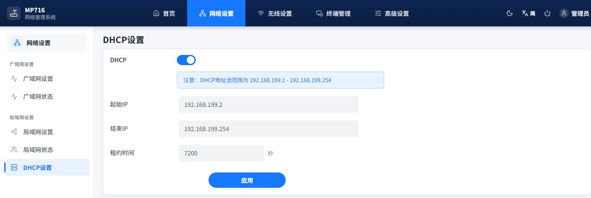

# MP716 1.0.3 DHCP 与 WAN MTU 修复验证

日期：2026-11-18。修复此前[设置写操作真机测试](mp716-1.0.3-settings-write-test.md)发现的两项问题。当前设备仍为 1.0.3，通过 SSH 热更新现有 Vue 资源及两个 ucode 后台模块；没有执行固件刷写、重启或触碰 Bootloader、Config、Factory 分区。

## 修复内容

- DHCP 数字输入经 Vue 转为 number。保存时先转换为字符串再去除空白，避免 `leasetime.trim is not a function`。新增挂载实际组件、修改数字输入、提交及确认/撤销的回归测试。
- WAN DHCP/static 的 MTU 同时写入接口和对应的 `config device`，复用已有匿名或命名设备配置；缺失时在建立回滚快照之后创建。拒绝重复设备、名称冲突、无效设备名及与 LAN 直接共用的设备，未改变 PPPoE 分支。
- 后台网络设置任务使用 `ubus call network reload` 通知 netifd，避免调用包含硬件交换机初始化的完整 init 脚本。应用与回滚共用此入口。
- 状态接口优先读取 `/sys/class/net/<device>/mtu`，避免把 netifd 缓存中的值当作内核实际值。

## 校验结果

| 检查 | 结果 |
| --- | --- |
| 前端测试 | 10 项通过，包含新增的 2 项 DHCP 组件回归测试 |
| 前端类型检查及生产构建 | 通过 |
| 主机测试 `python tests/run_all.py` | 54 项通过 |
| 实机 MIPS ucode 编译及隔离 fixture | 9 项通过，覆盖设备复用、新建、精确回滚、确认、无变化及非法配置拒绝 |
| DHCP 网页数字输入 | 7200 → 7260，应用并确认成功，dnsmasq 生成配置实际使用 7260 秒 |
| DHCP 网页手动回滚 | 7320 应用后回滚至上一确认值 7260，最后通过网页恢复并确认原值 7200，刷新读回一致 |
| WAN 实际 MTU 保存 | 原生后台提交 1498，内核接口和状态接口均为 1498，确认成功；再提交原值 1499 成功 |
| WAN 实际 MTU 手动回滚 | 临时 1497，取消后内核接口恢复 1499，network 文件恢复至测试基线 |
| WAN 实际 MTU 自动回滚 | 临时 1498，不确认、不查询任务，等待超过 90 秒；先由 SSH 核实 pending 已删除、原文件已恢复，再查询最终状态，实际接口为 1499 |
| 部署一致性 | 54 个 Vue 资源 HTTP 200 且 SHA256 与本地构建一致；设备端 ucode 与修复源码一致 |
| 联网 | 强制绑定电脑有线接口，后台 HTTP、路由器 DNS、经 WAN/NAT 的公网 HTTP 均通过 |

诊断期间曾发现直接从 SSH 复制配置并异步重载后，实际 MTU 没有及时恢复。该诊断结果没有被作为通过证据；最终验收使用真实后台提交反向配置，以及真实后台的取消、独立超时回滚，均核对了内核实际值。

## 配置保留及限制

核对测试前后的 **17 个配置、密码、SSH 密钥及升级配置文件的内容和权限**，无新增文件。除 network 中原有 `eth0.2` 设备增加 `mtu '1499'` 外，其余文件全部相同；该项用于让用户已有的 WAN MTU 1499 实际生效。测试前实际接口为 1500，结束为 1499，因此没有声称 network 文件逐字节不变。

原 Wi-Fi 名称、密码、管理地址 `192.168.199.1`、管理员登录、DHCP 和静态绑定保留。无线状态为启用；本轮没有重新关联无线客户端进行数据面复测，前次无线和终端 ACL 测试结果见原报告。当前无待确认任务，boot ID 未变，生产升级门保持 `closed`。临时失联恢复措施没有触发，验收后已停止，原后台回滚服务保留运行。

本次热修复不会改变既有 GitHub 1.0.3 ZIP 的内容；后续固件构建需包含本次修复提交。当前没有触发新的完整固件构建。

私有配置、备份及原始证据保存在本地被忽略的 `build/github-44259651926/settings-fix-103/`：`final-fix-verification.json`、`mtu-live-results.json`、`dhcp-7260-applied.json` 及 dnsmasq 配置。密码、用户终端明细和私有配置未提交公共仓库。
