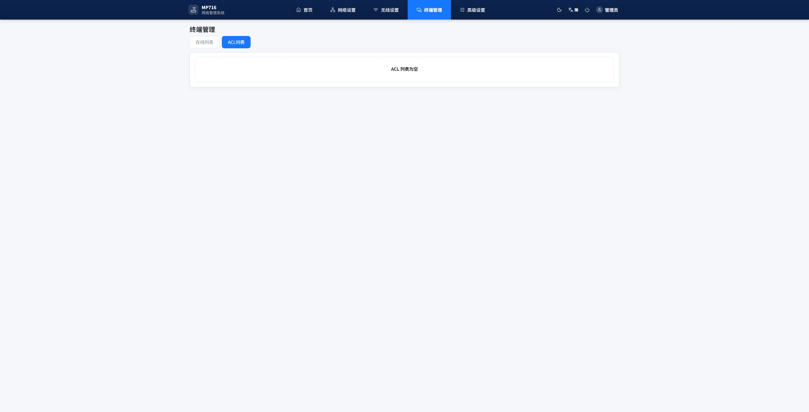

# MP716 1.0.3 保存、应用及回滚真机验证

日期：2026-11-18。用户授权验证现有 1.0.3 的网络、无线和终端管理写操作，测试后恢复原配置，不再刷机。本轮测试完成，整体设置功能尚未全部通过，确认两项待修复问题。

后续状态：以上两项已修复并在现机复测通过，见[DHCP 与 WAN MTU 修复验证](mp716-1.0.3-settings-fix.md)。本文保留修复前的原始测试结果。

设备运行 GitHub 构建提交 `c40b968a50b09ae35e0e812e1aff435c22fb5eb7` 的 1.0.3。没有热更新设备程序或重新刷写，保留原固件中的问题以便复现。

## 实测结果

| 范围 | 实际操作与证据 | 结果 |
| --- | --- | --- |
| WAN 网页保存 | 临时更改 DHCP 主机名，点击应用和确认保留；刷新并重新登录后读回临时值，SSH 与真实接口读回一致 | 通过 |
| WAN 网页手动回滚 | 再次更改主机名后点击回滚，恢复上一已确认值 | 通过 |
| WAN 自动回滚 | 90 秒确认窗口，不确认、不轮询任务接口；后台自行恢复原 network 文件 | 通过 |
| WAN MTU | 临时设置 1498，配置读回 1498，实际 `eth0.2` 及状态接口仍为 1500；取消后原文件恢复 | **实际应用未通过** |
| DHCP 网页租期保存 | 将 7200 修改为 7260 秒后点击应用，出现 `leasetime.trim is not a function`，没有创建配置任务，原 DHCP 文件未变 | **未通过** |
| DHCP 原生后端 | 直接调用同一真实接口保存 7260 秒，dnsmasq 生成配置实际使用 7260，确认保留后读回成功 | 通过 |
| DHCP 自动回滚 | 不确认临时租期，30 秒窗口后由后台恢复原 dhcp 文件 | 通过 |
| DHCP 静态租约 | 添加不占用当前地址的测试绑定，读回成功，再取消并比对原文件 | 通过 |
| 无线网页保存与应用 | 最大用户数从 32 改为 31，确认保留；真实 hostapd 配置出现 `max_num_sta=31` | 通过 |
| 无线网页手动回滚 | 改为 30 后点击回滚，页面恢复到上一已确认值 31 | 通过 |
| 无线自动回滚 | 原配置下临时设置 29，hostapd 实际应用；不确认，30 秒窗口后后台恢复原 wireless 文件 | 通过 |
| 终端 ACL 网页 | 辅助无线终端加入 ACL 后，列表、持久化文件和 nftables 均出现规则；移出后列表为空 | 通过 |
| 终端 ACL 实际流量 | 有线管理通道保持连接；无线终端新建外网连接被阻断，nft 丢包计数增加 4；移除规则后外网上网恢复 | 通过 |
| 管理终端保护 | 从有线管理连接尝试封锁该管理终端，真实接口拒绝，ACL 没有增加 | 通过 |

自动回滚验证先通过 SSH 检查原文件已恢复且 pending 文件已删除，然后才读取任务最终状态，避免把查询接口触发的过期处理当作独立后台回滚。网络重载会暂时断开连接，测试脚本仅对只读请求重连、对明确的锁忙响应等待；没有因不确定的断线重复提交配置写入。

终端 ACL 采用立即应用、移出规则撤销的机制，没有配置任务倒计时。其流量控制作用于转发流量；本次验证的是 WAN 阻断与恢复，没有把它解释为对路由器本机管理服务的全面隔离。

## 待修复问题

1. **DHCP 数字输入导致页面保存异常。** [DhcpPage.vue](../web/src/pages/network/DhcpPage.vue) 的数字输入经 Vue 转为 number，序列化时仍调用 `form.leasetime.trim()`。应兼容数字和字符串，并补充真实数字输入后的保存回归测试。后端保存、实际 dnsmasq 应用和自动回滚已经分别验证通过，不能用后端通过替代网页通过。
2. **WAN MTU 配置没有作用于实际接口。** [admin.uc](../integration/ram-web/admin.uc) 把值保存为 `network.wan.mtu`，但实测设置 1498 后运行接口仍为 1500。需要继续定位 netifd 设备配置或 DHCP 参数覆盖的影响，并以实际接口 MTU 验证修复，不能仅检查 UCI 值或成功提示。

本轮没有将这两项标记为已修复，也没有以已通过的基础上网测试代替设置写操作验收。

## 最终恢复与连接核验

- 测试前备份当前配置、密码、SSH 密钥、设备与升级配置。另在 `/tmp` 保存命名快照，并设置独立的失联超时恢复措施。
- 测试后对 **17 个原文件的内容和权限**逐项比对，全部一致，没有新增配置文件。原 Wi-Fi、管理地址、WAN、DHCP 和已有静态绑定均恢复。
- 原 ACL 文件起初不存在，测试后恢复为不存在；实际 nftables 的 blocked 集合为空，没有遗留测试封锁规则。
- boot ID 与测试前一致，没有重启；当前版本仍为 1.0.3，管理地址仍为 `192.168.199.1`，生产升级门保持关闭，后台模块与原构建源码一致。
- 分别强制绑定电脑的有线和无线接口，原 Wi-Fi 凭据关联、DHCP、管理页、路由器 DNS 及经 WAN/NAT 访问公网 HTTP 均通过。
- 电脑测试时软件无线原先关闭，按 [Microsoft WLAN API](https://learn.microsoft.com/en-us/windows/win32/api/wlanapi/nf-wlanapi-wlansetinterface) 临时开启，结束后恢复原关闭状态，并删除临时无线配置。
- 独立失联恢复没有被触发；测试结束后已停止该临时监控，原后台回滚服务保留运行。

私有备份、原始响应、配置文件、运行服务配置、测试脚本和截图保存在本地被忽略的 `build/github-44259651926/settings-103/`，最终结果为 `final-settings-verification.json`，其中 `overall_settings_acceptance_passed` 为 `false`。没有把密码、用户终端明细或私有配置提交到公共仓库。
