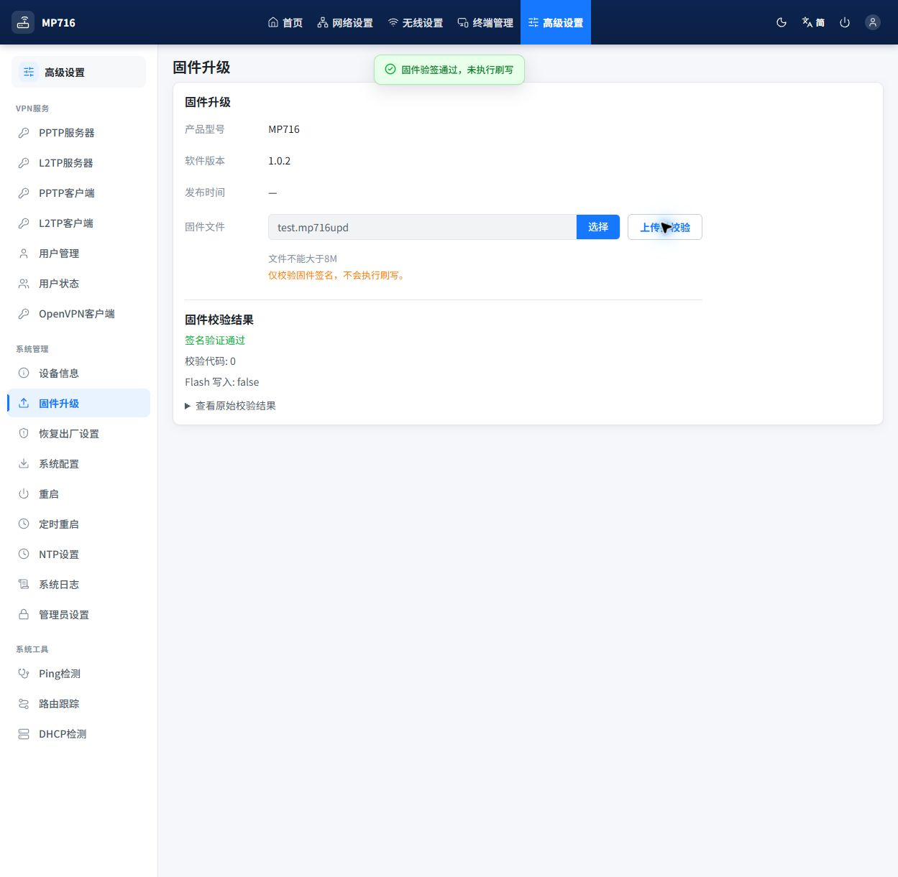

# MP716 1.0.3 构建与新版后台真机验签

日期：2026-11-18。完整 Vue 后台和配套验签公钥已进入 1.0.3 的 initramfs 与 sysupgrade 候选镜像；现机仍运行 1.0.2。本次没有升级固件或重启设备。

## 源码与 GitHub 产物

- 分支：`codex/mp716-versioned-artifacts`。
- 构建提交：`c40b968a50b09ae35e0e812e1aff435c22fb5eb7`。
- OpenWrt：官方 v25.12.6，固定提交 `64900e756efa667774214f9c6b17c113222e01f7`。
- [GitHub Actions #44259651926](https://github.com/miubond/openwrt/actions/runs/44259651926)：成功，总耗时 52 分 53 秒。
- [完整版本发布 ZIP](https://github.com/miubond/openwrt/actions/runs/44259651926/artifacts/14409858885)。
- [签名测试包 ZIP](https://github.com/miubond/openwrt/actions/runs/44259651926/artifacts/14411231331)。解压后使用 `test.mp716upd` 上传到新版后台的“上传并校验”。

版本发布目录为 `releases/1.0.3/targets/ramips/mt76x8/`。原生 OpenWrt 输出格式保留；镜像仍为 `UNVERIFIED`，生产刷写开关关闭。

| 文件 | 字节数 | SHA256 |
| --- | ---: | --- |
| `openwrt-25.12.6-ramips-mt76x8-yunxm_mp716-initramfs-kernel.bin` | 5488227 | `5065b74c9e4f070879eaa16729f30c195981f272e9298abb3820751ce70aacfe` |
| `openwrt-25.12.6-ramips-mt76x8-yunxm_mp716-squashfs-sysupgrade.bin` | 5570823 | `1c26c9728c8708737780a174a962d9d5e413b59a2e246fe2aefa75f3772cb5ed` |
| `test.mp716upd` | 5571371 | `19d8c32de560d73dd79348bb6799bab78d5a57869665368e4bb546ae6a800140` |

完整发布 ZIP 的 SHA256 为 `e1fdb724bf8f6c5e868e6c0373a95d6dbd177c993f6a41731f3e4b6cdc5ad887`；测试包 ZIP 为 `c5ee421d19be5df6385f565629842c4df72b076cefe1f3505b6daef71e9e7d59`。下载后均与 GitHub artifact digest 一致。

## 本次交付修复

CI 在构建两种镜像之前生成同一对测试签名密钥，把公钥显式传入 LAN 和 RAM 构建。随后从实际生成的 SquashFS 与 initramfs 中提取公钥，与签名包配套公钥逐字节比较；缺失或不匹配会终止打包。私钥不进入镜像或下载产物，包格式与原有 Ed25519 验签机制不变。

两种镜像包含完整 Vue 生产资源和原生 ucode 管理接口，包括网络设置、无线设置、终端管理、固件上传校验及配置应用回滚服务。增加构建版本标记，使接口读取实际镜像版本；修复回滚服务首次安装时仅启用、未启动的问题。本次没有修改内核、DTS、Flash 布局或升级写入业务逻辑。

验签公钥为该次 CI 的实验室测试公钥，32 字节；Key ID 为 `9501a650c8545a7c`，SHA256 为 `9501a650c8545a7c937d571588a9ea191b63bc2c5f0bb81c7a3b0ed12552fa09`。这不是生产签名密钥配置。

## 构建、缓存与离线检查

- 54 项主机测试、8 项前端测试、Vue 类型检查与生产构建通过；原生 ucode 在现机隔离的 `/tmp` 中编译与任务状态测试通过。
- GitHub 构建摘要：LAN 冷缓存构建 `2229.895 s`，RAM 命中相同工具链缓存后构建 `567.162 s`。
- 两者缓存指纹均为 `a1dc6b3d56044ba344a21f6b8af57b0b50684278ba2e50957dc24f9c57ad7489`。工作流结束时共享下载、主机工具和交叉工具链缓存保存成功。
- 下载后离线核对发布目录 31 个文件的 SHA256、构建提交、设备元数据、两种镜像内的公钥、完整 Vue 页面与静态资源、ucode 管理模块及镜像大小，全部通过。
- 签名包内负载逐字节对应同次发布的 sysupgrade 镜像；离线 Ed25519 验证通过。没有将用户私有配置和密码写入公开镜像。

## 真机上传校验

先在 MP716 的 `/tmp` 隔离目录中，以配套公钥和当前版本配置调用 `mp716-upgraded check --require-memory`，返回代码 0。通过后备份旧公钥，只更新 `/etc/mp716-upgrade/upgrade.pub`，没有替换现机后台程序或版本标记。

随后在现机完整 Vue 后台的固件页面，使用 Windows 文件选择框选择本次原始 `test.mp716upd`，点击“上传并校验”。页面实际显示“签名验证通过”、“校验代码: 0”和“Flash 写入: false”。请求经过现有原生 ucode 接口 `/cgi-bin/mp716/system/firmware-package/verify`。

同一真实 HTTP 接口复核结果：

| 检查 | 结果 |
| --- | --- |
| 原始 1.0.3 包 | HTTP 200，`ok: true`，`code: 0`，`signature_checked: true` |
| 仅翻转签名末尾一位 | HTTP 400，`code: 10`，`error: signature`，`signature_checked: false` |
| 两次请求的固件写入状态 | `flash_write: false`，`bytes_programmed: 0`，`erased: false`，`upgraded: false` |
| 原始包的结构检查 | LZMA 字典 8388608 字节，SquashFS 偏移 1957415，内核名 `MIPS OpenWrt Linux-6.12.112` |
| 当前运行版本 | 1.0.2，生产升级仍关闭 |

`accepted: false` 表示仅检查、没有接受执行升级；`custom_firmware_installed: false` 是检查报告中未填入的运行状态字段，不能据此判断实际装机状态。本次单独读取 ROM 版本及后台设备版本，均确认仍为 1.0.2。

## 配置与验证边界

测试前后逐字节比较 `/etc/config`、`/etc/shadow`、设备配置、刷写开关、平台确认状态及 boot ID，全部一致。原 Wi-Fi、管理地址、WAN 和其他已有配置保留，没有重启。仅安装了本次测试包所需的公开验签密钥，旧公钥已备份。

本地原始结果、配置备份和校验脚本保存在被忽略的 `build/github-44259651926/`。公开报告不包含登录凭据、无线密码或私有配置。

本次完成的是构建、静态检查和现机上传验签。没有从 RAM 启动 1.0.3，也没有执行 `sysupgrade` 写入、启动兼容性验收或恢复演练；候选镜像继续标为 `UNVERIFIED`。
