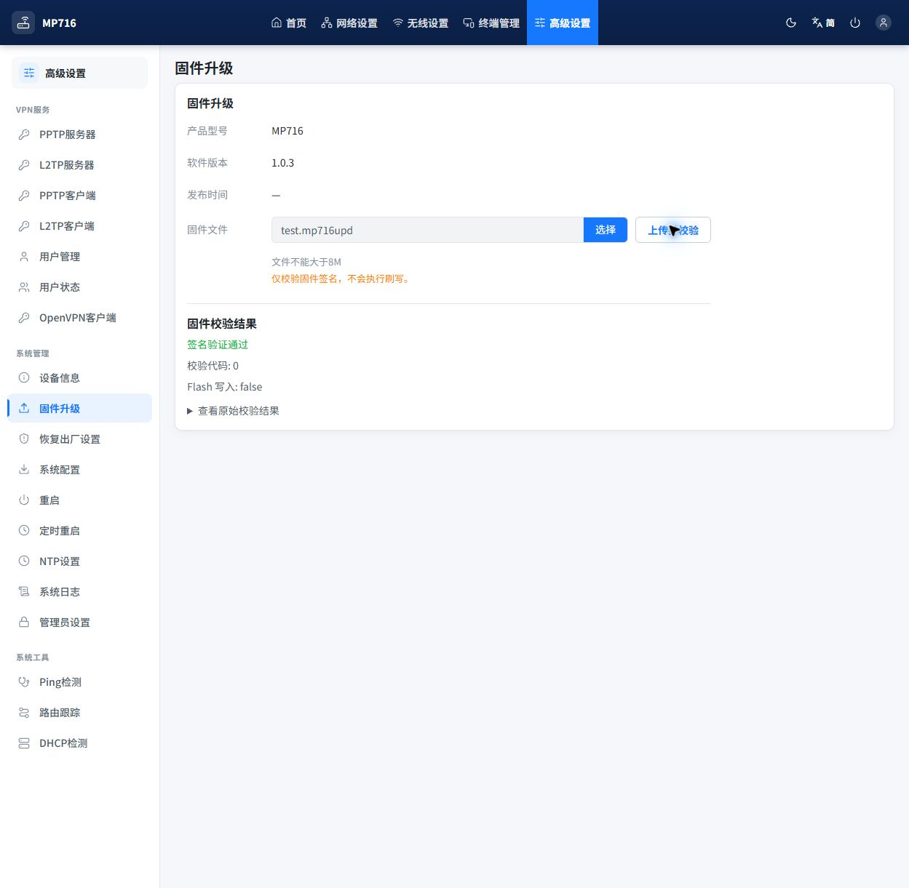

# MP716 1.0.4 构建及真机网页验签

日期：2026-11-18。1.0.4 纳入已在现机验证的 DHCP 数字输入保存修复、WAN 设备 MTU 应用及回滚修复。本轮仅构建、下载、离线检查及现机上传校验，未刷写固件或重启。

## 构建与下载

- 构建提交：`0d1ae66fe178d8babf5926f70fda1ab4c2f1f4c9`，分支 `codex/mp716-versioned-artifacts`。
- [GitHub Actions #44285071883](https://github.com/miubond/openwrt/actions/runs/44285071883) 成功，耗时 **38 分 53 秒**。
- [完整候选发布 ZIP](https://github.com/miubond/openwrt/actions/runs/44285071883/artifacts/14420229558)，17,088,889 字节，SHA256 `639f8902b801d611dcb5c0e5bb58973dde8c60213bf07705580c4bcc731a25f5`。
- [签名测试包 ZIP](https://github.com/miubond/openwrt/actions/runs/44285071883/artifacts/14421865714)，5,575,214 字节，SHA256 `cdca0ce204fd62c279394b913441e12cea46fb191eb66f768cdf9b8a493080e2`。解压后以 `test.mp716upd` 上传到自研后台“上传并校验”。

两份 ZIP 下载后均与 GitHub artifact digest 一致。版本发布目录为 `releases/1.0.4/targets/ramips/mt76x8/`，保留 OpenWrt 原生镜像格式及命名。所有镜像保持 `UNVERIFIED`，生产刷写门关闭。

| 文件 | 字节数 | SHA256 | 用途 |
| --- | ---: | --- | --- |
| `openwrt-25.12.6-ramips-mt76x8-yunxm_mp716-initramfs-kernel.bin` | 5,489,073 | `283d2f823bbf191f727fde8cae6e6c17da4fea291d863e1ae8618d2d288bf6f0` | RAM 启动候选，本轮未启动 |
| `openwrt-25.12.6-ramips-mt76x8-yunxm_mp716-squashfs-sysupgrade.bin` | 5,570,823 | `96fc15910fa52ed49d897500c75085c7f3c9a684f974f1961cd27e17d2f2b6d5` | sysupgrade 候选，本轮未刷写 |
| `test.mp716upd` | 5,571,371 | `541199cee01bf1d28ab6416bdc3a304d4b30bd0f8456982d02a70d3bc339ef59` | 现有自研后台上传验签 |

## 离线检查

核对发布目录 31 个文件的 SHA256、固定 OpenWrt v25.12.6 提交、MP716 元数据、Flash 大小上限、网卡与无线软件包、默认 NAT、防火墙及私有凭据未嵌入，均通过。实际解开 initramfs 与 sysupgrade 的文件系统，核对 `admin.uc`、`admin-state.uc`、`admin-tick.uc` 与构建提交一致；两种镜像中的 DHCP JavaScript 均包含数字租期转字符串的修复。

两种镜像内的公钥、独立签名 ZIP 的公钥、签名容器的公钥逐字节一致。Ed25519 验签通过，容器内负载逐字节对应同次构建的 sysupgrade 镜像。签名格式保持不变。

## 真机上传校验

现机保持 **1.0.3（含已验证热修复）**。先在 `/tmp` 的隔离目录使用现机 MIPS 原生校验器，以配套公钥校验 1.0.4；真实内存快照参与检查，返回 `code: 0`。随后备份旧测试公钥，只安装本次配套公开测试公钥，Key ID `c4874f3320635573`；旧 Key ID `9501a650c8545a7c` 已备份。

通过现有 Vue 后台，使用系统文件选择器选择本次原始 `test.mp716upd`，点击“上传并校验”。页面实际显示 **签名验证通过、校验代码 0、Flash 写入 false**，经过原生接口 `/cgi-bin/mp716/system/firmware-package/verify`。

同一 HTTP 接口另行复核：原包 HTTP 200、`ok: true`、`signature_checked: true`；只翻转签名末尾一位的包 HTTP 400、`code: 10`、`error: signature`。两次均为 `flash_write: false`、`bytes_programmed: 0`、`erased: false`、`upgraded: false`。

## 配置与验证边界

对比测试前后全部 `/etc/config`、管理员凭据、SSH 密钥、设备与版本标记、生产升级门及平台确认文件，内容相同。仅配套测试公钥更新；Wi-Fi、管理地址 `192.168.199.1`、WAN 和 DHCP 配置保留。实际 WAN MTU 1499，无线状态为启用，无待确认任务。boot ID 未变，未重启，设备仍为 1.0.3。

本次验签不代表 1.0.4 已实机启动或恢复路径已验收。1.0.4 沿用既有后台功能范围，VPN、诊断等高级页面仍有未完成适配的入口；后续以 `openwrt_system` 为主的独立 Web 包及完整功能迁移不属于本次构建。

私有备份、原始校验响应及脚本保存在本地被忽略的 `build/github-44285071883/`，包括 `offline-verification.json`、`device-prepared.json`、`final-device-verification.json`。未把凭据或用户私有配置提交公共仓库。
