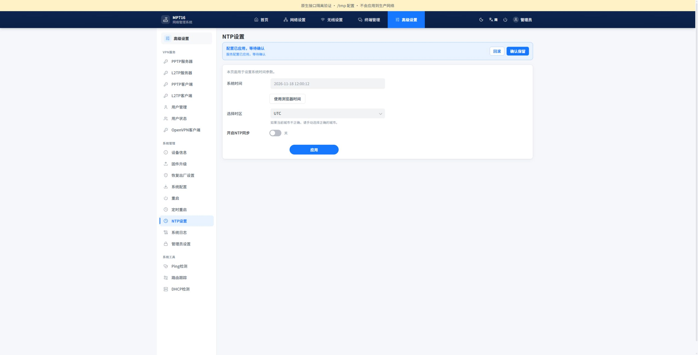

# MP716 1.0.5 原生后台候选验证

固件版本 1.0.5，Web 版本 0.2.0，上游 OpenWrt v25.12.6。状态 **UNVERIFIED**，禁止将此报告作为生产刷写或完整硬件验收证明。

## 源码

- 主 UI：`D:\goweb\src\openwrt_system`，提交 `0a76c150a2273ae88cfa8b6ab4b8754c9c406ff5`。
- 固件内生成快照：167 个输入文件，树 SHA256 `034af0cdf0a9af138e9699e3bd31e0b917dea9bbdebab68309ec98b5152512f7`。
- 候选分支：`codex/mp716-native-admin-105`。当前工作分支及无关的迁移重打包脚本未覆盖或发布。

## 已完成的验证

| 范围 | 实际结果 | 边界 |
| --- | --- | --- |
| 主前端 | 33 个测试文件、190 项通过；类型检查及 native 构建通过 | 包括真实 HTTP 方法、向导只在 confirmed 后结束、异步应用和回滚反馈 |
| Linux 主机 | 最终提交 106 项回归通过，完整 DHCP Linux 实现编译及 ASan/UBSan 报文检查通过 | 不在主机测试中发 DHCP 报文 |
| Web 独立包 | 8 项通过 | 缺登录前置、健康或任务状态路由时拒绝能力预检 |
| 现机原生 ucode | 184 项隔离接口断言、6 项真实异步子进程断言通过；网关编译通过 | 所有配置及快照位于 `/tmp` 私有目录，生产服务命令不执行 |
| HTTP | 51 项通过 | 实际鉴权、路由、保存、确认、取消、失败恢复与失败后重试；最终服务仅为私有 sleep/exit 脚本 |
| 浏览器 | 完整 Vue 页面加载、NTP 保存待确认、回滚后表单恢复通过 | 明确显示隔离环境横幅，不修改生产网络或时间 |

升级前的这次隔离测试在 1.0.3 上完成。该阶段测试前后 `/etc/config`、root 凭据、升级门控及 boot ID 一致；没有刷机或重启。临时 HTTP 服务在验证完成后关闭。旧主机没有 BusyBox timeout，真实 worker 测试使用只允许私有假服务的有界兼容脚本，1 秒期限自测通过；脚本不进入固件。候选自身的 BusyBox timeout 仍须专门验收。

## 构建检查与修复

[首轮完整构建 #44308663458](https://github.com/miubond/openwrt/actions/runs/44308663458) 在 `make defconfig` 后因 `CONFIG_PACKAGE_strongswan-isakmp` 未保留而终止，没有生成可用固件。固定 packages feed 的子包对 `strongswan` 使用非自动选择的父包约束；增加显式父包选择，并要求最终 `.config` 同时保留基础包、ISAKMP、KDF、SHA2、charon、ipsec 和 stroke。PPP 基础包也显式选择。

RAM/LAN 的最终文件检查使用同一个清单，验证全部自研模块、PPP 插件、StrongSwan 插件及加载配置、内核模块和托管服务启动链接；拒绝厂商包默认 VPN 自启动链接。保留 8,060,928 字节分区硬上限；默认 VPN 关闭；保留原有签名格式与关闭的生产刷写门。失败日志现在包含 defconfig 输出和解析后的构建配置。

固定 feed 的 `gmpdh` 还需目标平台 `gmp.h` 与静态 `libgmp.a`，但原配方只在另一插件启用时声明依赖。本轮在校验精确源码版本和散列后幂等补充 `PKG_BUILD_DEPENDS:=gmp python3/host`；GMP 源已有静态库和开发文件安装，不选择额外运行时包。5 项配方测试通过。存在此已知缺口的 #44434175163 已取消。

工具链缓存改为独立恢复/保存。编译或后续镜像检查失败后，仅当有界 C 程序的交叉编译和链接通过、只读 ELF 检查为 ELF32/LSB/MIPS，才保存 host/toolchain；不执行该目标程序、不缓存 target/rootfs/私钥，保留原构建退出码，取消任务不保存，缓存上传失败不阻断发布。7 项故障测试通过。缓存成功不表示固件或硬件验收成功。

默认 ESP 提案还需要保证内核 SHA256/XCBC 算法已交付；用户态 SHA2 插件或内核自动选中模块都不能代替 rootfs 中的算法。StrongSwan 配方增加对应软件包，LAN/RAM 构建后分别核对最终选择及 `sha256_generic`、`libsha256`、`xcbc` 的同版本模块。内建算法必须提供交付的 `modules.builtin` 内容证明；没有证明则停止交付并明确要求审查。相关配方和算法检查的 16 项针对性测试通过。该检查证明算法交付，不证明远端隧道互通。

同一 CI、相同固定源码/宿主参数/内层 key 内保留 `hostpkg`，避免 RAM 阶段第二次编译启用优化构建的宿主 Python；仍清空 target、overlay、公钥及设备 profile。远端缓存不包含 hostpkg，不声明跨任务复用宿主包。外层缓存可按同平台前缀恢复，实际复用仍以严格的源码 pin、宿主 ABI、编译器/链接器/make 和工具链输入的内层 key 判定；不匹配的目录不移动、不当作命中。两镜像的耗时和命中状态随版本产物交付。

宿主包复用还由每对构建的独立会话限制：换会话、缺失/无效会话或符号链接 marker 均清理宿主包，保守处理持久化的自托管 runner。会话保护测试在 Windows 上 6 项通过、真实符号链接权限测试跳过；该用例在 Linux CI 中保留执行。既有 7 项缓存故障测试再次通过。

## 最终构建与下载包核验

冻结固件提交 `80f7b4a967300e0968ea50581daec6ffd353f78a` 的 [GitHub 构建 #44443686119](https://github.com/miubond/openwrt/actions/runs/44443686119) 已成功。任务于北京时间 2026-11-19 10:21:20 至 11:21:39 运行，共 1 小时 00 分 19 秒；镜像编译检查步骤用时 58 分 24 秒。没有重发构建或修改该冻结源码。

| 镜像 | 实际字节数 | SHA256 | 编译及检查耗时 |
| --- | ---: | --- | --- |
| initramfs | 6,733,613 | `222d21bd458e8a1d32586a74881dd65a159edfb3413d36ab6e961efdb2d68afa` | 1,068.359 秒（17 分 48 秒） |
| sysupgrade | 6,816,007 | `b13770e69d0beb3b91631ee0f472f87dc7dafec6b33a9f13b89a1d995e8ab288` | 2,406.457 秒（40 分 06 秒） |

两份产物的 `reports/{sysupgrade,initramfs}/build-timing.txt` 均明确记录工具链 cache hit，内层 key 同为 `b06bf8237352ddf65554798a9ef9d5bb805fb38f7a31ad5fbc497baea823ac0a`。命中工具链不意味着复用 target/rootfs；本轮仍实际编译两种镜像。外层缓存恢复 29 秒，保存 43 秒；新缓存实体 `10764514730` 已实际存储。

- [完整版本发布 ZIP](https://github.com/miubond/openwrt/actions/runs/44443686119/artifacts/14495546981)：20,913,327 字节，SHA256 `3143391b3963f643da04530eaf5e6396110c14ee1d8b1be10aca13e3f91c3311`。
- [配套签名测试 ZIP](https://github.com/miubond/openwrt/actions/runs/44443686119/artifacts/14495247686)：6,820,398 字节，SHA256 `9a4bbb5eef4e15fbf594d515f7a3af9ab7f3222b62a8f6bb77a87ecb5a1c8e62`。

两份 ZIP 已下载到本机 `build/github-44443686119/`，GitHub 外层 digest 与 ZIP CRC 均通过。[实际离线报告](../build/github-44443686119/offline-verification.json) 的 `ok=true`：35 个校验项、38 个自研安装文件与冻结源码逐字节匹配、53 个完整 Vue 构建文件在 RAM/LAN 中一致、两镜像来源及固件/Web 版本一致；独立读取两个 rootfs 的 SHA256/XCBC 算法模块并检查同内核版本；托管启动链接及无冲突 VPN 自启动项检查通过。294 个指定范围的 etc/Web 文件在每份镜像中完成秘密材料检查，这不是对所有可能秘密的通用无遗漏证明。

`test.mp716upd` 的独立签名校验为 `ok=true`、`signature_checked=true`、`flash_write=false`，签名 key ID `e9e280d22b018cf9`；载荷与本次 sysupgrade 镜像逐字节相同，独立签名 ZIP 与完整发布 ZIP 内的包和公钥一致。该包是自研验签接口的实验候选，不是已确认可上传原厂 014 后台的首次迁移格式。

离线审查中修正了主机校验器对 Linux CPIO 链接末尾 NUL、OpenWrt stock rpcd/uhttpd 引用和固定 feed 禁用 OpenVPN 示例的解析误报；精确正反例通过。未因此修改固件包或交付源码。生产刷写门仍关闭，离线报告中 `hardware_validated=false`、`target_binaries_executed=false`、`flash_write=false`；CI 的 fake-stage boot 检查不等同于真实启动。离线审查结束时现机为 1.0.3，该阶段配置未更改。

随后用户明确授权保配置升级，本次 1.0.5 已实际写入并成功启动，原配置及有线/Wi-Fi/WAN 基础验收通过。该后续操作不是上述离线测试的一部分，实际写入与验证证据单独见 [1.0.5 实机升级记录](mp716-1.0.5-device-test.md)。浏览器逐页点击因用户停止自动操作而未完成；VPN/恢复/长期负载仍未验收，不能将基础联网通过扩大为全部功能或生产验收通过。

## 待验收

新镜像启动及配置保留、RAM 启动与恢复路径、64 MiB 内存压力、实际 VPN 远端认证和隧道互通、PPP/XFRM/证书及 bind mount、物理 LAN1–LAN4 对应、GPIO 与长期稳定性。未验证的蜂窝/APN、11B 新配置、原厂私有无线参数、可选 MPPE 和 TAP 不声明可用。
