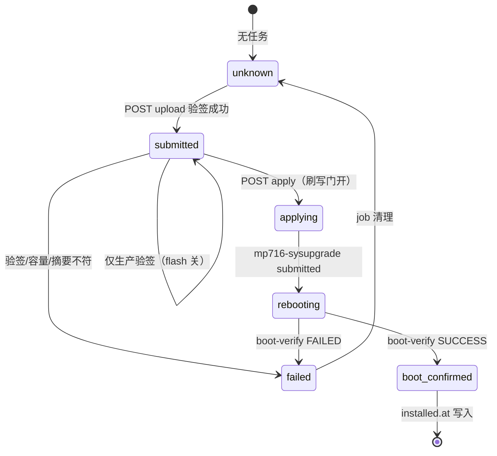

# MP716 固件升级：生产安全、容量与状态机

更新：2026-11-26

## 1. 升级状态机



| 对外 `state` | 含义 | 持久化 |
|------------|------|--------|
| `submitted` | 镜像在 `/tmp/mp716-upgrade/jobs/{id}.mp716upd`，验签通过 | `active-job.json` + meta |
| `applying` | CGI 已提交异步刷写 | job meta + `state=APPLYING` |
| `rebooting` | `REBOOT_REQUIRED` / `BOOT_VERIFYING` | `/etc/mp716-upgrade/state` |
| `boot_confirmed` | 新版本运行确认 | `SUCCESS` + `installed.at` |
| `failed` | 任一步失败 | history / job failed |
| `unknown` | 无任务或状态不明 | — |

**生产默认**：`flashUpgradeEnabled=false`，仅能到达 `submitted`；`apply` 返回 `403`。

---

## 2. 17 条需求对照

| # | 要求 | 实现 | 实机 |
|---|------|------|------|
| 1 | 验证模式不写 Flash | `run_check(..., require_no_flash)`；`mp716-upgraded` JSON `flash_write:false` | **VERIFIED**（网页刷写经验） |
| 2 | 上传仅 `/tmp` | `job_image_path` → `/tmp/mp716-upgrade/jobs/` | **VERIFIED** |
| 3 | 有界缓冲 | `STREAM_CHUNK=65536` 流式 `stdin.read` | **VERIFIED** |
| 4 | 上传前后容量 | `firmware_capacity_check` MemAvailable + `df /tmp` | **UNVERIFIED**（需压测） |
| 5 | `job_id` 两阶段 | upload 返回 `job_id`；`?job_id=` 或 `firmware-v2/apply` | **UNVERIFIED**（待 Web 切 v2） |
| 6 | 签名校验 / SHA256 / 板型 | `mp716-upgraded check`（manifest、分区、`yunxm,mp716`） | **VERIFIED** |
| 7 | 配置备份空间 | apply 路径 `--keep-config` → `sysupgrade -b`；无 keep 时 pending-only | **UNVERIFIED**（满配置压测） |
| 8 | `sysupgrade -T` | `mp716-sysupgrade` 子进程 | **VERIFIED**（实验室刷机） |
| 9 | 禁止 `-F` 强刷 | `mp716-sysupgrade` 拒绝 `-F`/`--force` | **VERIFIED**（`test_sysupgrade_adapter.py`） |
| 10 | apply 前再验签 | `reverify_job_image` 尺寸+`check`+SHA256 | **UNVERIFIED** |
| 11 | 状态区分 | 见状态机 + `GET firmware-v2/status` | **UNVERIFIED** |
| 12 | 仅 boot 后记成功 | `record_firmware_installed` 移至 `firmware-boot-confirm.uc` | **UNVERIFIED**（待重启） |
| 13 | CGI 不直接刷写 | `setsid` 子进程 `submitted` | **VERIFIED** |
| 14 | 防重复任务 | `/tmp/mp716-upgrade/job.lock` + `active-job` | **UNVERIFIED** |
| 15 | 失败清理 | `job_cleanup` 不删 applying/rebooting 镜像 | **UNVERIFIED** |
| 16 | CI 尺寸门禁 | `build-openwrt-test.sh` 8060928；`check-mp716upd-artifact-size.py` | **VERIFIED**（CI 脚本） |
| 17 | VERIFIED/UNVERIFIED | 本文「实机」列 | — |

---

## 3. 容量计算报告（MP716）

| 资源 | 常量 | 说明 |
|------|------|------|
| Flash 分区 | **8 060 928 B**（7872 KiB） | `yunxm_mp716.mk` / `FIRMWARE_BYTES` |
| 上传上限 | 8 060 928 B | httpd + 门禁一致 |
| RAM | ~57 MiB 可用（64 MiB 扣保留） | 实验室观测 |
| 上传内存预算 | `ceil(file/1024) + 8192` KiB | 包 + 8 MiB staging |
| tmpfs 预算 | `ceil(file/1024) + 512` KiB | 包 + 元数据 |
| 流式缓冲 | 64 KiB | 单次 read 上限 |

**宿主单测**：`tests/integration/test_firmware_capacity_gate.py`。

---

## 4. API（v2）

| 方法 | 路径 | 生产 |
|------|------|------|
| GET | `system/firmware-v2/info` | `dryRunOnly: true` |
| POST | `system/firmware-v2/upload` | octet-stream，返回 `job_id` |
| GET | `system/firmware-v2/status` | `?job_id=` |
| POST | `system/firmware-v2/apply` | **403**（无刷写门） |

兼容 v1：`POST firmware-package/verify` 验签返回 `job_id`；`?mode=flash&job_id=` 二段 apply。

---

## 5. 代码入口

- `integration/ram-web/firmware-job.uc` — 任务、容量、复验
- `integration/ram-web/httpd.uc` — HTTP 网关
- `integration/ram-web/firmware-boot-confirm.uc` — 启动确认写 `installed.at`
- `integration/openwrt-package/files/usr/sbin/mp716-sysupgrade` — 异步 apply
- `scripts/check-mp716upd-artifact-size.py` — CI 包体门禁

---

## 6. 测试报告（本次宿主）

```bash
cd mp716-firmware-upgrade
python -m pytest tests/integration/test_firmware_capacity_gate.py -q
python scripts/check-mp716upd-artifact-size.py build/ci-release/test.mp716upd  # 需先 pack
```

- `test_firmware_capacity_gate.py`：分区常量与构建脚本门禁 **PASS**（已运行）
- `test_sysupgrade_adapter.py`：gate / async / 禁止 force — **回归需在 WSL/Linux**
- 网页 E2E：**UNVERIFIED**（本次未刷写）

---

## 7. 生产验收清单

- [ ] `GET system/firmware` → `flashUpgradeEnabled=false`，`validationOnly=true`
- [ ] `GET system/firmware-v2/info` → `dryRunOnly=true`，`partitionBytes=8060928`
- [ ] 上传正式签名包 → `signature_checked=true`，`flash_write=false`，收到 **16 位 hex `job_id`**
- [ ] 镜像落盘路径在 `/tmp/mp716-upgrade/jobs/`，**不存在**于 `/overlay` 下新增包文件
- [ ] `POST firmware-v2/apply`（带 `job_id`）→ **403** 且无 `sysupgrade` 进程
- [ ] 重复并发上传 → **409 DEVICE_BUSY**（第二路）
- [ ] 实验室开门后：`apply` → `detail=submitted` → 重启 → `boot-verify` → `boot_confirmed` → 发布时间更新
- [ ] CI：`build-openwrt-test.sh` 镜像 ≤ 8060928；`check-mp716upd-artifact-size.py` 对 RELEASE 包 PASS
- [ ] 不存在 `allow-flash-upgrade` 与未验收 `-F` 刷写路径

---

**说明**：本次会话**未**在实机执行 `sysupgrade`/`mtd write`（符合生产约束）。实验室刷写验收请在 `allow-flash-upgrade` 开启后按第五节清单执行。