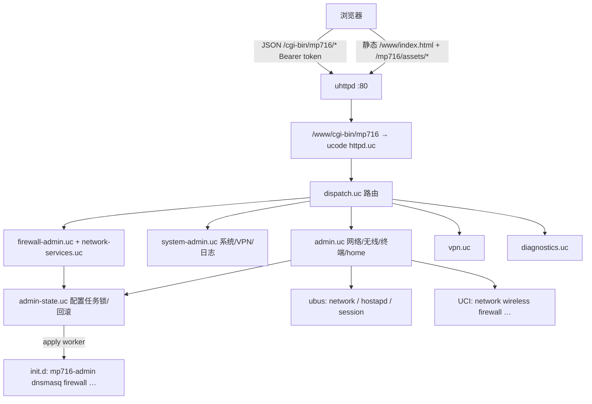

# MP716 自研栈：当前实现架构（2026-11-25）

适用实机：**OpenWrt 1.0.10**、Web **0.2.3**、API **`mp716-native/v1`**。实验室设备 **192.168.199.1**，已替换原厂华翼 Web，不并存 `cgi_huayi`。运行边界见 [实机运行状态](mp716-device-runtime-state.md)。

## 1. 仓库与职责

```text
D:\goweb\src\
├── openwrt\mp716-firmware-upgrade\   # 固件工程（本仓库）
│   ├── integration/ram-web\          # 设备侧 CGI / ucode（权威后端）
│   ├── web\                          # openwrt_system 的生成快照（勿手改页面）
│   ├── packer\ / integration\openwrt-package  # 签名校验、sysupgrade 门
│   └── scripts\deploy-*、publish-lab-port-map.py
└── openwrt_system\                    # Vue 管理面主源码
    ├── src\                          # 页面、适配器、契约
    └── dist-openwrt\                 # build:openwrt 产物 → 部署到 /www
```

| 变更类型 | 改哪里 | 上设备方式 |
|----------|--------|------------|
| 页面/菜单/API 调用 | `openwrt_system` | `npm run deploy:native` |
| 接口/UCI/缓存 | `integration/ram-web/*.uc` | 同上（热更 `.uc` + `native-routes.json`） |
| 整包镜像 | 本仓库 CI / `build-openwrt-*.sh` | sysupgrade（生产门默认关） |

## 2. 运行时分层（路由器）



### 2.1 Web 前端

- **入口**：`/www/index.html` → `/mp716/assets/index-*.js`（Vite 分包）。
- **适配器**：`DeviceRouterAdapter` → `fetch('/cgi-bin/mp716/' + path)`，Header 带 ubus 会话 token。
- **契约**：`native-web-contract.json`、`contract-manifest.ts`；缓存与串行队列减轻首页并发（dashboard 12s 服务端缓存等）。

### 2.2 API 网关

- **`httpd.uc`**：唯一 CGI；登录走 `ubus session login`；统一 `{ ok, data|code, message, ts }`。
- **`dispatch.uc`**：按模块委托 `route_system` → `route_vpn` → `route_diagnostics` → `route_firewall` → `route_network_services` → `route_admin`。
- **路由表**：`native-routes.json`（含 `GET home/dashboard`、`firewall/*`、`network/upnp|ddns` 等）。

### 2.3 核心业务模块（ucode）

| 模块 | 职责 |
|------|------|
| `admin.uc` | 首页聚合 `home/dashboard`、WAN/LAN/DHCP/无线/终端、向导 |
| `physical-ports.uc` + `port-links.sh` | 交换机口链路；`/etc/mp716-admin/port-map.json` 外壳标签 |
| `admin-tick.uc` | 定时 warm API 缓存 |
| `system-admin.uc` | 时间/NTP、日志、备份恢复、密码、重启、定时重启 |
| `firewall-admin.uc` | 防火墙规则、端口转发、DMZ（config-task） |
| `network-services.uc` | UPnP、DDNS（`upnpd`/`ddns` UCI） |
| `vpn.uc` + 附属 | PPTP/L2TP/OpenVPN 客户端与服务端 |
| `diagnostics.uc` | Ping/路由跟踪/DHCP 检测 |
| `admin-state.uc` | 全局锁、pending 任务、**确认后 apply / 超时 rollback** |
| `capabilities.uc` | `system/capabilities`、路由列表、`physicalLanOrderVerified` 等 |

### 2.4 配置应用模型

1. 多数写操作：**POST** → 写 UCI 快照 → 返回 `taskId` + 倒计时。
2. 用户 **确认** 或 **取消** → `system/config-task/*`。
3. Worker 执行：`/etc/init.d/firewall reload`、`ubus call network reload` 等（见 `admin-state.uc` `reload()`）。

## 3. 与原厂差异（架构层面）

| 维度 | 原厂 | 当前实现 |
|------|------|----------|
| 前端协议 | HYID + `cgi_huayi` | REST 路径 + JSON |
| 后端 | 闭源 | ucode + OpenWrt UCI/ubus |
| 刷机 | stream CGIs | `mp716-package-verify` + 验签 sysupgrade（生产 validationOnly） |
| 4G/Modem | `cgi_modem` | 未实现（`wanModes: wired`） |

菜单级能力对齐见 [factory-full-parity-roadmap.md](factory-full-parity-roadmap.md)。

## 4. 部署与运维路径

**日常热更（当前常用）**

```text
openwrt_system: npm run build:openwrt && npm run deploy:native
  → overlay /www/mp716 + /usr/share/mp716/{admin,dispatch,firewall,...}.uc
  → /etc/init.d/mp716-admin restart
```

**物理口校准**

```text
scripts/publish-lab-port-map.py --install
  → /etc/mp716-admin/port-map.json
```

**整包固件**

```text
openwrt_system 构建 web/dist → stage.py --web-dist
  → squashfs-sysupgrade（UNVERIFIED；生产升级门见 production-acceptance.md）
```

## 5. 关键路径索引

| 用途 | 路径 |
|------|------|
| 后端源码 | `integration/ram-web/` |
| 前端源码 | `../openwrt_system/src/` |
| 契约 | `openwrt_system/native-web-contract.json` |
| 路由清单 | `integration/ram-web/native-routes.json` |
| 打包 stage | `integration/ram-web/stage.py` |
| 热更脚本 | `openwrt_system/firmware/scripts/deploy-native-openwrt.ps1` |
| 实机状态 | [mp716-device-runtime-state.md](mp716-device-runtime-state.md) |
| API 说明 | [mp716-native-web-api.md](mp716-native-web-api.md) |

## 6. 已知边界（实现内声明）

- 原厂 **108 HYID** 未做字节兼容。
- **QoS / 多 SSID / 双 WAN / stream 刷机 / 4G** 未全开或显式 `supported: false`。
- 物理口 **LAN1–WAN** 依赖每台设备的 `port-map.json`，非全局默认值。
- 镜像与能力标记多为 **UNVERIFIED**；`flashUpgradeEnabled` 生产默认关闭。

更新：结构说明仍覆盖 1.0.7 起的原生栈。2026-11-25 实验室实机版本、网页热更新和刷写限制以 [实机运行状态](mp716-device-runtime-state.md) 为准。