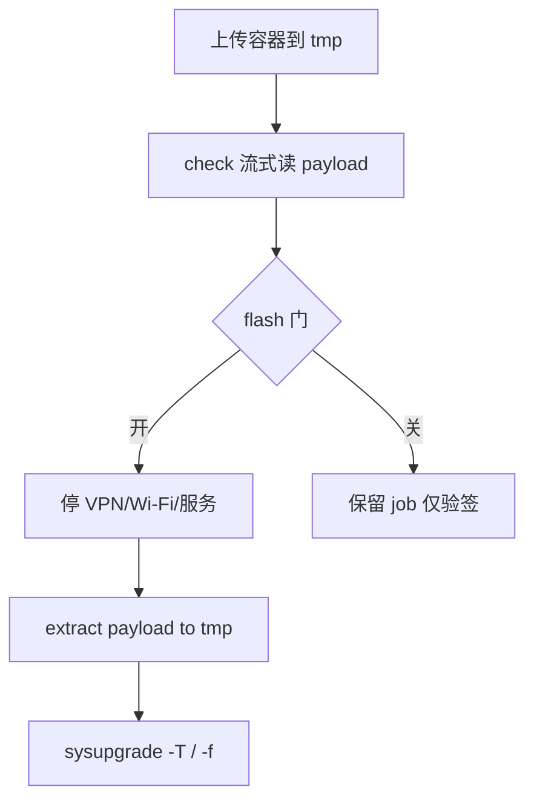

# MP716 升级内存与 tmpfs 报告

更新：2026-11-26  
Profile：**64 MiB RAM**，tmpfs **28.5 MiB**（实机）

## 1. 实机基线（证据）

| 指标 | 值 | 来源 |
|------|-----|------|
| MemTotal | 58 460 KiB | `/proc/meminfo` |
| **MemAvailable** | **17 620 KiB** | 同左（2026-11-26 09:49） |
| tmpfs /tmp 总 | 28.5 MiB | `df /tmp` |
| tmpfs 已用 | 656 KiB | 同左 |
| Overlay 剩余 | 772 KiB | `df /overlay` |

`reports/device-size-probe-2026-11-26.json`

## 2. 内存模型（`mp716-upgraded`）

C 实现 `mp716_memory_allows()`（`device/src/system_info.c`）：

| 阶段 | 需满足 |
|------|--------|
| upload | `MemAvailable ≥ payload + 8 MiB` |
| verify | `MemAvailable ≥ 2 MiB` |

常量与 Python `packer/image_format.py`：`UPLOAD_RESERVE_BYTES=8MiB`，`VERIFY_RESERVE_BYTES=2MiB`。

**1.0.11 包单次上传预算（宿主推算）**：

- payload ≈ 6 947 079 B → **需 ~14 973 KiB Available**
- 实机 **17 620 KiB** → **余量 ~2.6 MiB**（紧张但够一次上传）

WireGuard/VPN 握手占用未在本轮加压；**UNVERIFIED**。

## 3. HTTP / ucode 路径（`firmware-job.uc`）

| 要求 | 实现 |
|------|------|
| 单次上传 | job 一次；`active-job` 防并发 |
| 流式 /tmp | 64 KiB chunk，`cat >` 管道 |
| 不复刻整包入 ucode | 无 `stdin` 全量缓冲 |
| 不写 Overlay | 仅 `/tmp/mp716-upgrade/jobs/*` |
| Content-Length | 循环至 `got == size`，否则删文件 |
| 验签内存 | `check --meminfo /proc/meminfo --require-memory`（本轮新增） |
| 上传前后容量 | `firmware_capacity_check` MemAvailable + `df /tmp` |

## 4. 刷写路径（`mp716-sysupgrade`）

| 要求 | 实现 |
|------|------|
| 不在 CGI 内刷写 | `setsid` + `submitted` |
| 拒绝仅靠降 `min_free_kbytes` | **刷写前先判** MemAvailable/tmp（本轮新增 exit 25/26） |
| 两份完整固件 | 容器 job 文件 → extract 后删容器；峰值仍 payload+staging |
| sysupgrade -T | 子进程 `sysupgrade -T` 后异步 `run.sh` |
| 配置备份 | keep：`sysupgrade -b`；需 tmp + RAM peak（**大配置 UNVERIFIED**） |

预检公式（shell）：

```text
need_mem_kb = payload_kb + 8192 + 2048
need_tmp_kb = payload_kb + 512
```

## 5. 升级状态与 `flash_write`

| 阶段 | `flash_write` | `upgraded` |
|------|---------------|------------|
| 验签 / job submitted | false | false |
| apply HTTP 返回 | true | **false** |
| boot-verify SUCCESS | — | true（C 状态机） |
| 发布时间 | — | 仅 `firmware-boot-confirm.uc` |

## 6. 峰值场景（理论）



同时存在：**最多一份**容器 + **解压副本**（短暂）→ 设计在子进程且尽早 `rm` 容器。

## 7. 测试证据

| 测试 | 结果 |
|------|------|
| `test_firmware_capacity_gate.py` | **3/3 PASS** |
| `mp716_memory_allows` / container | `tests/packer/test_container.py` **14+ PASS** |
| 实机低内存拒绝 apply | **UNVERIFIED**（未注入 cgroup 限内存） |
| 上传中断 | **UNVERIFIED** |

## 8. 建议后续（不减功能）

1. 实验室：在 64 MB 上 `stress` 压 MemAvailable < need，期待 HTTP 507/JSON `low_memory`。
2. keep-config + 接近满 overlay 的 `-b` 失败路径。
3. VPN 运行中升级：记录 `mp716-vpn stop` 后 Available 差值。

**本轮未热更设备** `firmware-job.uc` / `mp716-sysupgrade`（避免无人值守刷写风险）。